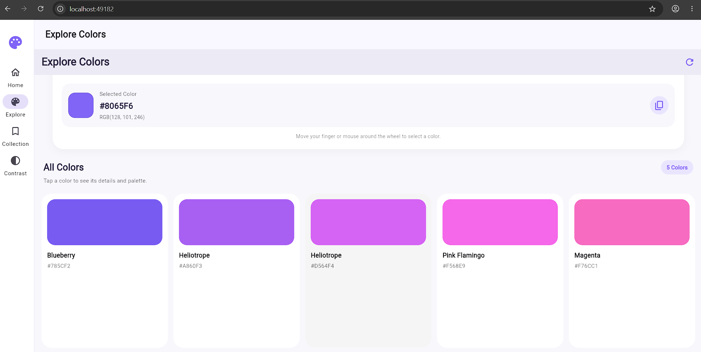
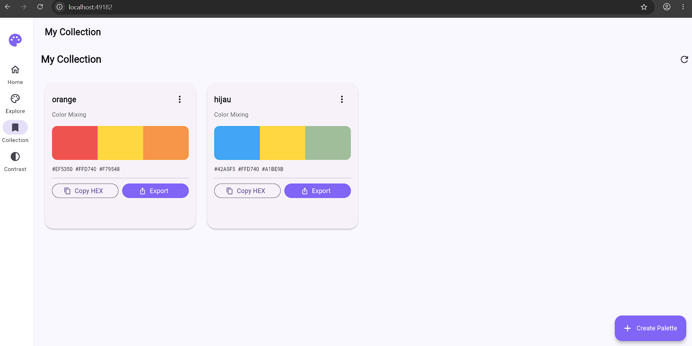
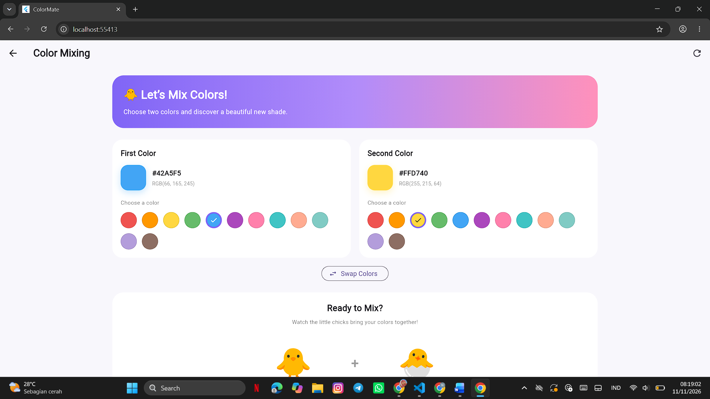
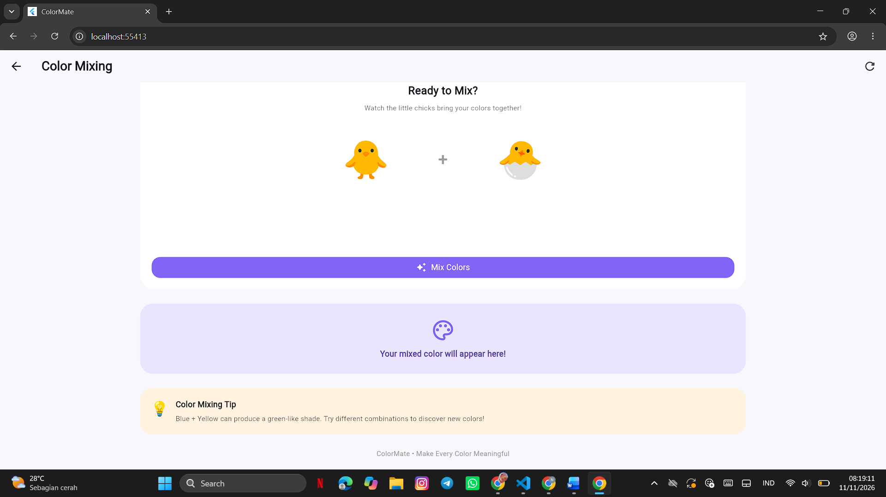

# 🎨 ColorMate

### Explore Colors, Create Palettes, and Save Your Creativity.

ColorMate adalah aplikasi berbasis Flutter yang dirancang untuk membantu pengguna mengeksplorasi warna, melihat informasi warna, mencoba pencampuran warna, serta menyimpan warna favorit. Aplikasi ini juga memanfaatkan REST API untuk memperoleh informasi dan kombinasi warna serta Supabase untuk pengelolaan data koleksi.

---

## 👩‍💻 Project Identity

| Keterangan | Informasi |
|---|---|
| Nama | Ni Komang Trisna Cahyani |
| NIM | 2415051072 |
| Kelas | PTI 5 B |
| Program Studi | Pendidikan Teknik Informatika |
| Jurusan | Teknik Informatika |
| Fakultas | Teknik dan Kejuruan |
| Universitas | Universitas Pendidikan Ganesha |
| Mata Kuliah | Pemrograman Mobile |
| Dosen Pengampu | Dr. Ir. I Ketut Resika Arthana, S.T., M.Kom. |

---

## ✨ Features

ColorMate memiliki beberapa fitur utama, yaitu:

1. **Explore Colors**  
   Menjelajahi berbagai pilihan warna melalui tampilan yang interaktif.

2. **Color Detail**  
   Menampilkan informasi detail mengenai warna yang dipilih.

3. **Color Picker**  
   Memilih warna dan memperoleh informasi kode warna.

4. **Color Mixing**  
   Mempelajari pencampuran warna dan melihat hasil kombinasi warna.

5. **Palette Generator**  
   Membantu menghasilkan kombinasi palet warna.

6. **Save Color**  
   Menyimpan warna pilihan ke dalam koleksi.

7. **Color Collection**  
   Melihat dan mengelola warna yang telah disimpan.

8. **Palette Collection**  
   Mengelola koleksi palet warna.

9. **CRUD Operations**  
   Menambahkan, menampilkan, memperbarui, dan menghapus data koleksi.

10. **Responsive Design**  
    Mendukung tampilan aplikasi pada perangkat desktop dan mobile.

---

## 🛠️ Technologies

Teknologi yang digunakan dalam pengembangan ColorMate:

| Teknologi | Kegunaan |
|---|---|
| Flutter | Framework pengembangan aplikasi |
| Dart | Bahasa pemrograman |
| Material Design 3 | Desain antarmuka |
| Provider | State management |
| REST API | Mengambil data warna |
| The Color API | Sumber informasi dan kombinasi warna |
| Supabase | Backend dan pengelolaan data |
| PostgreSQL | Database |
| Git | Version control |
| GitHub | Penyimpanan repository |

---

## 🌐 REST API Integration

ColorMate menggunakan **The Color API** untuk memperoleh informasi warna dan menghasilkan kombinasi warna.

**API Endpoint:**

```text
https://www.thecolorapi.com/scheme
```

**HTTP Method:** GET

**Response Format:** JSON

Data dari API diproses menggunakan model Dart agar dapat digunakan dan ditampilkan pada antarmuka aplikasi.

---

## 🗄️ Database

ColorMate menggunakan Supabase sebagai layanan backend dengan PostgreSQL sebagai sistem database.

Database digunakan untuk mendukung pengelolaan koleksi warna dan palet.

Operasi database yang diterapkan meliputi:

- **Create:** Menambahkan data warna atau palet.
- **Read:** Menampilkan data koleksi.
- **Update:** Memperbarui data yang tersimpan.
- **Delete:** Menghapus data dari koleksi.

---

## 🏗️ Project Architecture

Pengembangan ColorMate menggunakan pemisahan tanggung jawab dengan pendekatan Provider, Repository, dan Service.

Struktur direktori utama:

```text
lib/
├── config/
│   └── supabase_config.dart
│
├── models/
│   ├── color_info.dart
│   └── palette.dart
│
├── providers/
│   ├── color_provider.dart
│   └── palette_provider.dart
│
├── repositories/
│   ├── color_repository.dart
│   └── palette_repository.dart
│
├── screens/
│   ├── collection_page.dart
│   ├── color_detail_page.dart
│   └── explore_page.dart
│
├── services/
│   ├── color_api_service.dart
│   └── palette_supabase_service.dart
│
├── widgets/
│   ├── color_card.dart
│   ├── color_swatch.dart
│   └── loading_widget.dart
│
└── main.dart
```

### Architecture Flow

```text
UI / Screens
     |
     v
  Providers
     |
     v
 Repositories
     |
     v
   Services
     |
     v
REST API / Supabase
```

**Penjelasan:**

- **Models:** Mengatur struktur data warna dan palet.
- **Services:** Menangani komunikasi dengan REST API dan Supabase.
- **Repositories:** Menjadi penghubung antara Provider dan Service.
- **Providers:** Mengelola state aplikasi menggunakan Provider.
- **Screens:** Menampilkan halaman aplikasi.
- **Widgets:** Menyediakan komponen antarmuka yang dapat digunakan kembali.
- **Config:** Menyimpan konfigurasi koneksi Supabase.

---

## 📸 Application Screenshots

Berikut dokumentasi tampilan aplikasi ColorMate.

### 1. Home

.png)

### 2. Explore Colors

.png)



### 3. Color Collection



### 4. Color Mixing





### 5. Save Color


### 6. Additional Application Screenshot


---

## 🚀 How to Run

Untuk menjalankan ColorMate secara lokal, pastikan perangkat sudah memiliki Flutter SDK dan Dart SDK.

### 1. Clone Repository

```bash
git clone https://github.com/trisnacahyani-ops/colormate.git
```

### 2. Masuk ke Folder Project

```bash
cd colormate
```

### 3. Install Dependencies

```bash
flutter pub get
```

### 4. Configure Supabase

Pastikan konfigurasi Supabase pada project sudah diisi menggunakan URL project dan publishable key yang sesuai.

Jangan membagikan secret key atau service role key ke repository publik.

### 5. Run Application

```bash
flutter run
```

---

## 📱 Build APK

Untuk menghasilkan aplikasi Android dalam format APK release, jalankan perintah:

```bash
flutter build apk --release
```

File APK akan tersedia pada direktori:

```text
build/app/outputs/flutter-apk/app-release.apk
```

---

## 🌍 Live Demo

ColorMate juga tersedia dalam versi web yang dapat diakses melalui browser.

**Live Demo:**

https://inquisitive-crisp-18e26b.netlify.app/

---

## 🔗 GitHub Repository

Source code ColorMate dapat dilihat melalui repository berikut:

https://github.com/trisnacahyani-ops/colormate

---

## 🎯 Project Objective

Project ColorMate dikembangkan sebagai implementasi pembelajaran Pemrograman Mobile dengan menerapkan Flutter, pengelolaan state, integrasi REST API, serta operasi CRUD menggunakan Supabase.

Melalui project ini, diharapkan pengguna dapat mengeksplorasi warna dan mengelola koleksi warna dengan lebih mudah melalui aplikasi yang interaktif dan responsif.

---

<p align="center">
  <b>ColorMate — Explore Colors, Create Palettes, and Save Your Creativity.</b>
  <br>
  Developed with Flutter 💜
</p>